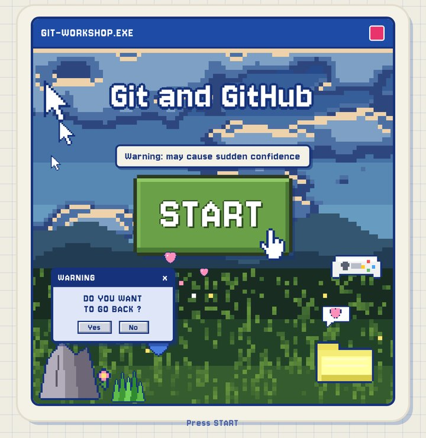
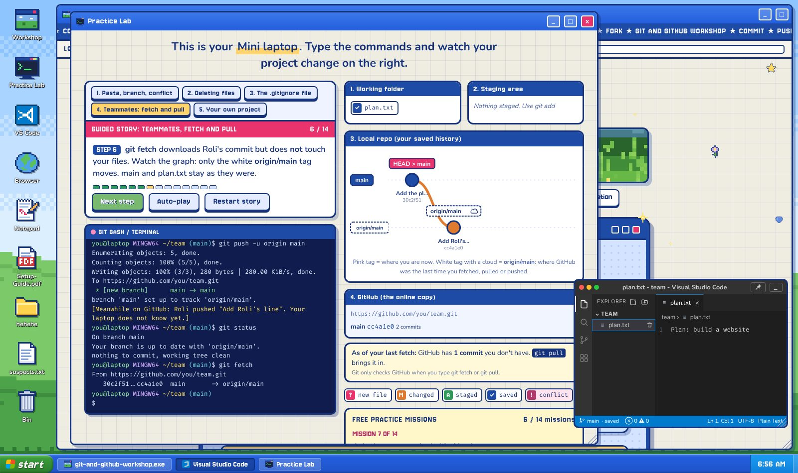

# Git & GitHub Workshop

**Warning: may cause sudden confidence.**

Most people meet Git as a black window full of words like *rebase*, *HEAD* and *detached*. Then they close it and email themselves `report_FINAL_v3.docx`.

This workshop starts somewhere friendlier: a tiny pixel computer in your browser. Press **START** and you get a desktop with lessons that explain everything from zero, a Practice Lab with a real-feeling terminal, and a code editor. Whatever you read about, you can try straight away, on a computer you can't break.

## How you learn

1. **Read a little.** Every idea gets one plain sentence, a picture and something to click.
2. **Try it for real.** Open the Practice Lab and type the actual Git commands, or click the same buttons you'd use in VS Code. Git answers the way real Git does, error messages included.
3. **Break things on purpose.** Cause a merge conflict, delete a file, undo it. Nothing leaves your browser unless you want it to.

## What's inside

**Five lessons**, from "what even is Git?" to working in a team:

| | Lesson | You'll learn |
|---|---|---|
| 1 | Introduction | What Git and GitHub are, why everyone uses them, and how to install Git |
| 2 | Repositories | Repos, commits, the staging area, remotes, push, pull and clone |
| 3 | Branching and teamwork | Branches, merging, pull requests, conflicts and forks |
| 4 | Keeping it tidy | `.gitignore`, READMEs and good habits |
| 5 | Practice lab | Everything above, hands-on |

**The Practice Lab**, where it clicks. It's an app on the desktop, so a lesson can stay open right beside it.

- **Five guided stories** play out step by step while you watch:
  1. A pasta recipe that ends in a merge conflict.
  2. A deleted file you bring back.
  3. A password you keep out of GitHub with `.gitignore`.
  4. **Teammates:** Roli pushes while you're not looking. `git status` still says *up to date*, `git fetch` shows what changed, `git pull` brings it in, and a bonus ending turns it into a conflict.
  5. **Your own project:** type a folder name, your name and email, and the setup is done for you. Then it's your turn: make a file, `git add .`, `git commit` and `git push` it yourself.
- **Missions** for every story, to try on your own, with a *Type it for me* button for when you're stuck. In *Your own project* there's no button: you type it all yourself.
- **A live picture** of your working folder, staging area, commit history and GitHub, updating with every command you type. The graph shows where `origin/main` is, so you can watch `git fetch` move it and `git pull` catch up. Every commit shows which files it added, changed or deleted: click it to see the list.
- **A VS Code window** with the Explorer, Source Control and the merge conflict buttons, so the first time you open the real thing, it already looks familiar.

**The Git it understands**, the everyday commands (and the terminal basics around them), answering like the real thing:

| | |
|---|---|
| Start | `init`, `clone`, `config` |
| Save | `status`, `add`, `commit`, `diff`, `show`, `log` |
| Undo | `restore`, `reset`, `revert`, `stash` |
| Files | `rm`, `mv`, `.gitignore` |
| Branches | `branch`, `switch`, `checkout`, `merge`, `tag` |
| GitHub | `remote`, `push`, `fetch`, `pull` |
| Terminal | `ls`, `cd`, `mkdir`, `touch`, `echo`, `cat`, `mv`, `cp`, `rm` |

The **Cheat Sheet** on the desktop lists every one of them with a line on what it does, a search box, and a *Try it* button that types the command into the terminal for you, and *Copy* for pasting it into your own Git Bash later.

Every folder can be its own repo. Clone one into another folder, push from the clone, and the original sees it after a `git fetch`.

**The Mini laptop** around it all: open apps, open folders in the File Explorer (folders inside folders too), or right-click and *Open with VS Code*, select several things at once (Ctrl-click, Shift-click or drag a box) and drag them into folders, change the wallpaper, rescue things from the Bin. Pin VS Code or the drawing Notepad on top. The Start menu search finds lessons, apps, your files, settings and Git commands: type what you want to do, like *undo* or *upload*, and it suggests the command, with a *Try it* button. There's also a setup guide for installing the real tools afterwards, and a folder of memes: real picture files you can open, `git add`, commit and push to GitHub. It comes with a practice task (`task.txt`): upload the folder without leaking the secret key hidden in it.

**Real GitHub mode** for when you're ready: connect a throwaway repo, and your `git push` lands on GitHub for real. Make a folder on the desktop, write a file in VS Code, and push it. `git clone` works with any repo on github.com you can see (big ones come down with their newest 50 commits). In the Teammates story you play the teammate yourself, editing a file on github.com, and *Your own project* goes straight to your real repo. Use a token you delete straight after the workshop.

## How it's different

There are great Git visualizers out there, like *Learn Git Branching*, which draws the commit graph as you type. This workshop shows the whole picture instead:

- **All four places at once:** your working folder, the staging area, your local history and GitHub, updating with every command.
- **Fetch vs pull you can see:** `origin/main` moves on its own after `git fetch`, and `git status` can say *up to date* when it isn't.
- **A VS Code look-alike,** with Source Control and the merge conflict buttons, so the real editor feels familiar later.
- **Real GitHub mode:** the same commands push to an actual repo.
- **A whole workshop, not just a sandbox:** guided stories, missions, and a little desktop with folders, a Bin and a File Explorer.
- **One HTML file:** works offline and on phones, nothing to install.

## Running a workshop with it

- Everyone opens the same link. It works on laptops, tablets and phones, with no accounts and nothing to install.
- It's one HTML file, so it also works offline: hand it out on a USB stick if the Wi-Fi gives up.
- The **Setup-Guide.pdf** on the desktop walks people through installing Git, Git Bash and VS Code and connecting to GitHub, on Windows or Linux.

---

Made by **Nishita, Yashieta, Abhinav, Aryan and Vasu**.

*5 friends, 1 workshop, 0 merge conflicts.*

